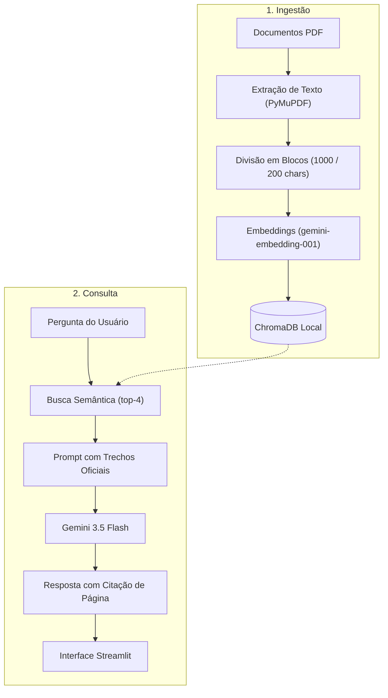

# Institutional RAG Assistant

Assistente baseado em *Retrieval-Augmented Generation (RAG)* para consulta de documentos institucionais, como estatutos sociais, regimentos internos, atas de reuniões e manuais de processos.

O objetivo do projeto é facilitar a localização rápida de regra e procedimentos operacionais, garantindo que as respostas sejam extraídas estritamente dos documentos cadastrados e acompanhadas da página e do arquivo de origem.

---

## Como Funciona

O sistema opera em duas etapas:

1. **Ingestão e Indexação (Offline):**
   - Leitura dos arquivos PDF via **PyMuPDF**, preservando a paginação original.
   - Higienização básica do texto e divisão em blocos de até 1.000 caracteres com 200 caracteres de sobreposição.
   - Vetorização dos blocos com o modelo `gemini-embedding-001` da Google AI Studio.
   - Armazenamento vetorial persistido localmente em disco via **ChromaDB**.

2. **Busca e Geração de Respostas (Online):**
   - A pergunta do usuário é convertida em vetor e comparada aos trechos salvos (busca por similaridade de cosseno, trazendo os 4 blocos mais relevantes).
   - Um prompt instrui o modelo (`gemini-3.5-flash`) a responder exclusivamente com base no contexto recuperado. Caso a informação não conste nos arquivos, o modelo informa que o dado não foi encontrado.
   - A resposta final indica o documento e a página consultada, e a interface exibe os trechos exatos utilizados.



---

## Tecnologias Utilizadas

- **Python 3.11+**
- **LangChain (LCEL)**: Cadeia de recuperação e geração.
- **Google Gemini API**: `gemini-embedding-001` (embeddings) e `gemini-3.5-flash` (geração).
- **ChromaDB**: banco vetorial embutido com persistência em SQLite local.
- **PyMuPDF (`fitz`)**: extração de texto e metadados de página.
- **Streamlit**: interface web.

---

## Estrutura do Repositório

```text
institutional-rag-assistant/
├── data/
│   ├── raw_private/          # Documentos internos (ignorado no Git)
│   ├── sample_public/        # Documentos de exemplo para testes locais
│   └── chroma_db/            # Base vetorial gerada localmente (ignorado no Git)
├── src/
│   ├── config.py             # Configurações, caminhos e leitura de variáveis de ambiente
│   ├── ingestion.py          # Leitura, limpeza de texto e chunking de PDFs
│   ├── vector_store.py       # Criação, persistência e retriever do ChromaDB
│   └── rag_engine.py         # Prompt institucional, cadeia LCEL e citações
├── app.py                    # Interface web em Streamlit
├── .env.example              # Modelo de variáveis de ambiente necessárias
├── requirements.txt          # Dependências do projeto
└── README.md                 # Documentação de uso e arquitetura
```

### Sobre os Documentos

Para permitir que qualquer pessoa teste o projeto após clonar o repositório, a pasta `data/sample_public/` contém dois PDFs de exemplo (um estatuto social e um manual financeiro fictícios). Caso queira usar documentos próprios da sua organização, basta colocá-los em `data/raw_private/` — essa pasta já está configurada no `.gitignore` e não será enviada ao repositório.

---

## Como Rodar Localmente

### 1. Pré-requisitos
- Python 3.11 ou superior
- Uma chave de API gratuita do [Google AI Studio](https://aistudio.google.com/)

### 2. Clonar o projeto e criar o ambiente virtual

```bash
git clone https://github.com/Mickaell-Oliveira/institutional-rag-assistant.git
cd institutional-rag-assistant

# Criar ambiente virtual
python -m venv .venv

# Ativar no Windows (PowerShell)
.\.venv\Scripts\Activate.ps1

# Ativar no Linux / macOS
source .venv/bin/activate
```

### 3. Instalar dependências

```bash
pip install -r requirements.txt
```

### 4. Configurar a chave de API

Copie o `.env.example` para `.env`:

```bash
cp .env.example .env
```

Abra o `.env` e insira sua chave do Google Gemini:

```env
GEMINI_API_KEY=sua_chave_aqui
GEMINI_LLM_MODEL=gemini-3.5-flash
GEMINI_EMBEDDING_MODEL=models/gemini-embedding-001
CHROMA_PERSIST_DIR=./data/chroma_db
CHUNK_SIZE=1000
CHUNK_OVERLAP=200
RETRIEVER_K=4
```

### 5. Iniciar a aplicação

```bash
streamlit run app.py
```

O navegador abrirá automaticamente em `http://localhost:8501`.

1. Na barra lateral, selecione a pasta de documentos (por padrão, `sample_public`).
2. Clique em **"Indexar / Atualizar Base"** para gerar os embeddings e salvar o banco local.
3. Digite sua dúvida no chat. Abaixo de cada resposta, abra o menu **"Fontes consultadas"** para ver a página e o trecho de onde a resposta foi retirada.

---

## Testes

O projeto inclui testes unitários para os pipelines de leitura, persistência e resposta:

```bash
python -m unittest discover -s . -p "test_*.py"
```
